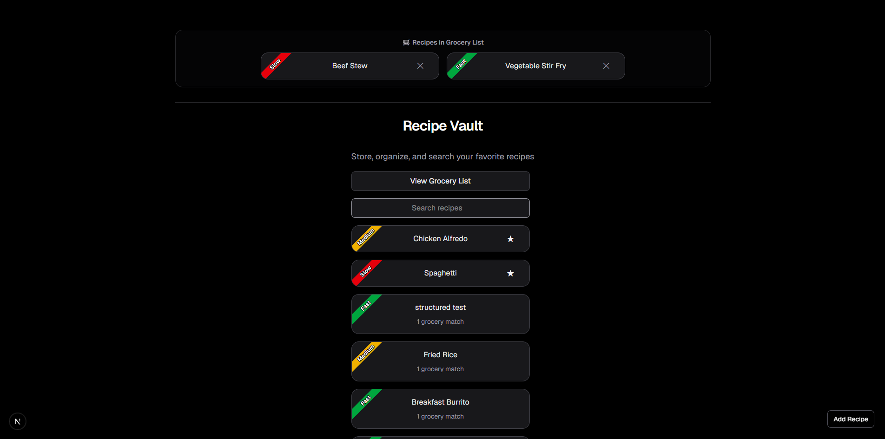
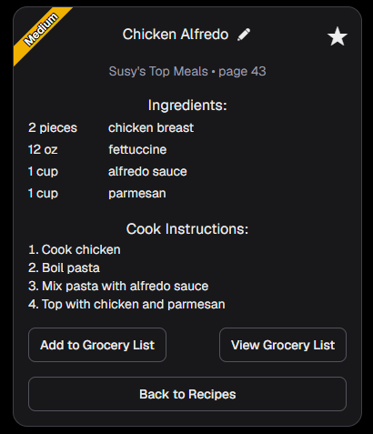
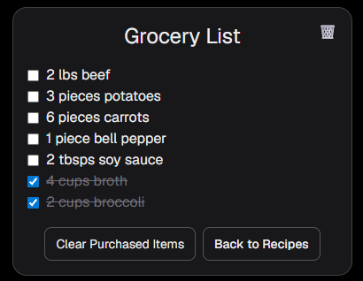
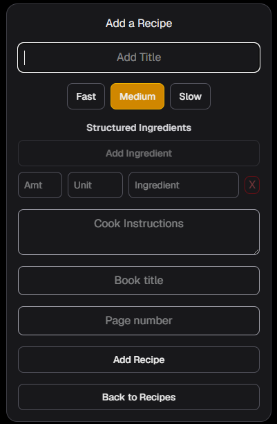

# Recipe Vault

## Overview

Recipe Vault is a recipe management web application built with Next.js, React, TypeScript, and Tailwind CSS.

Users can create, edit, organize, and browse recipes while generating a grocery list directly from recipe ingredients. Recipes and favorites are stored in PostgreSQL through Prisma. Grocery lists remain local to each browser.

Current scope is a single-user collection shared between desktop and iPhone. The app works locally; production deployment, access protection, and tested backup recovery remain unfinished. There is no authentication, so the app should not be exposed publicly until both pages and API routes are protected. See the [project status](docs/project-status.md) for current findings and the [launch todo](docs/launch-todo.md) for the development order.

## Screenshots

### Homepage



### Recipe Detail



### Grocery List



### Add Recipe



## Project Docs

- [Project status and roadmap](docs/project-status.md)
- [Launch todo](docs/launch-todo.md)
- [Manual smoke test checklist](docs/manual-smoke-test.md)
- [Backup and restore notes](docs/backup-restore-notes.md)

## Running the Project

Install the locked dependencies:

```bash
npm ci
```

Create a `.env` file with a PostgreSQL connection string. In PowerShell:

```powershell
Copy-Item .env.example .env
```

Or in Bash:

```bash
cp .env.example .env
```

Then replace the placeholder values:

```bash
DATABASE_URL="postgresql://..."
```

For local database development with Prisma Postgres, start the database:

```bash
npm run db:dev
```

Use `npm run db:dev:detach` to start the local database in the background. Set `DATABASE_URL` to the PostgreSQL connection URL printed by that command. An existing PostgreSQL database can also be used.

Apply database migrations:

```bash
npm run db:migrate:dev
```

If Prisma needs a separate shadow database for migration validation, set `SHADOW_DATABASE_URL` in `.env` to a second disposable database URL.

Seed starter recipes:

```bash
npm run db:seed
```

In a separate terminal, start the development server:

```bash
npm run dev
```

Open:

```text
http://localhost:3000
```

in your browser.

To check whether the app can reach the database, open:

```text
http://localhost:3000/api/health
```

## Verification

Run the standard local checks:

```bash
npm run check
```

Confirm required environment variables are configured:

```bash
npm run check:env
```

Before deployment, run the full preflight check:

```bash
npm run preflight
```

`npm run check` validates the Prisma schema, generates Next.js route types, checks TypeScript, lints the code, and runs the unit/route tests. Run `npm run typecheck` for type checking alone. `npm run check:env` checks the required database connection settings without printing secrets. `npm run preflight` runs those checks and then creates a production build; it does not prove database connectivity or migration readiness.

Run browser workflow tests separately:

```bash
npx playwright install chromium
npm run test:browser
```

Playwright starts and stops a local test server on port 3100; set `E2E_PORT` if that port is occupied. Avoid running another development server for this checkout at the same time. Tests cover desktop and mobile-sized Chromium with intercepted API responses. They do not write to PostgreSQL or replace live database and iPhone Safari testing. See the [manual checklist](docs/manual-smoke-test.md) for those checks.

The production build downloads Google fonts and requires network access. Recheck dependency advisories with `npm audit` and `npm audit --omit=dev` before release.

After starting the app, run a health smoke test:

```bash
npm run smoke:health
```

The health smoke test fails if the endpoint does not respond within 10 seconds. Set `HEALTH_CHECK_TIMEOUT_MS` to adjust that timeout.

For a deployed environment, set `APP_URL`:

PowerShell:

```powershell
$env:APP_URL="https://your-deployed-site.example"
npm run smoke:health
```

Bash:

```bash
APP_URL="https://your-deployed-site.example" npm run smoke:health
```

For production or hosted environments, apply committed migrations with:

```bash
npm run db:migrate:deploy
```

To inspect migration state before deploying, run:

```bash
npm run db:migrate:status
```

Use `prisma migrate dev` only for local development when creating or testing new migrations.

## Key Features

### Recipe Management

* Create custom recipes
* Edit existing recipes
* Delete recipes
* Favorite recipes
* Automatic slug generation from recipe titles
* Dynamic recipe detail pages
* Database-backed recipe storage through PostgreSQL and Prisma
* Database-backed favorite recipe storage
* JSON backup export for recipes and favorites
* Temporary localStorage import path for older browser-saved recipes

### Structured Ingredient System

Ingredients are stored as structured objects rather than plain text.

```ts
type Ingredient = {
    amount: number | "";
    unit: string;
    name: string;
};
```

This enables:

* Ingredient validation
* Ingredient aggregation
* Flexible ingredient display
* Grocery list generation
* Future measurement-based enhancements

### Grocery List

* Add recipe ingredients to a grocery list
* Remove recipe ingredients from a grocery list
* Individual grocery recipe removal from homepage grocery section
* Persistent grocery list storage within the same browser and origin
* Persistent grocery recipe tracking
* Prevent duplicate grocery recipe entries
* Grocery ingredient match counting
* Purchased item tracking
* Clear purchased items
* Automatic sorting of checked and unchecked items
* Ingredient aggregation

Example:

```text
1 cup milk
3 cups milk
```

Displays as:

```text
4 cups milk
```

### Search and Organization

* Search recipes by title
* Search recipes by ingredient name
* Search recipes by time category
* Dynamic filtering
* Grocery match indicators
* Favorite recipe prioritization
* Grocery recipe prioritization
* Empty-state messaging

### Recipe Details

* Structured ingredient display
* Cookbook support
* Page number support
* Cook instruction rendering
* Favorite toggling
* Grocery list integration

## Technical Highlights

### Reusable Components

* RecipeCard
* RecipeForm
* SearchBar
* BackButton

### Dynamic Routing

Recipe detail pages are generated using dynamic routes:

```text
/recipes/[slug]
```

### Persistence

Recipe create, read, update, delete, and favorite operations use PostgreSQL through Prisma and Next.js API routes. A legacy localStorage bridge remains for older browser data.

Database-backed behavior currently includes:

* Reading recipes from PostgreSQL
* Creating recipes from the Add Recipe page
* Updating database recipes from the Edit Recipe page
* Deleting database recipes from the Edit Recipe page
* Reading and toggling favorite recipes through PostgreSQL
* Importing older browser-saved favorites into PostgreSQL
* Exporting database recipes and favorites as a JSON backup
* Checking app/database readiness through a health check endpoint
* Seeding starter recipes into PostgreSQL
* Mapping database records into the application recipe shape

localStorage still persists:

* Grocery lists
* Grocery recipe tracking
* Unimported legacy recipes and favorites
* Recovery copies retired from the active collection during migration

Starter recipes are stored in source control as seed data and imported into the database with `npm run db:seed`. Older localStorage recipes can be imported from the homepage. Once a database record is confirmed, its matching browser copy moves to a recovery archive and stops participating in the collection. The database version stays active even if the archived version differs. Failed imports and unconfirmed records keep their local copies.

Legacy favorites follow the same retirement rule after a successful read/import. Missing-recipe favorites remain pending and retry on a later page visit. Favorite controls wait for migration to finish so a delayed import cannot undo a toggle made during that migration. Cleanup applies to each browser/origin separately; database changes on another device appear after reload.

**Download Legacy Recovery** appears on the homepage when archived copies exist. Save that file outside the browser before clearing site data. It preserves older browser versions and is separate from **Export Backup**, which exports the current database. Neither download currently has a general restore UI; see [backup and recovery notes](docs/backup-restore-notes.md).

If active browser data cannot be read, a recovery screen offers the original contents as a download, Retry, and a confirmed reset of only the damaged entry. Blocked storage offers Retry without a reset. Nothing is silently replaced with an empty list. General handling of failed grocery writes remains planned.

Browser storage is tied to a URL's origin. A hosted app cannot read legacy data from localhost. Moving to hosting requires an explicit database transfer or validated export/restore procedure. Grocery lists are not included in the current backup export.

### Data Modeling

A structured ingredient model replaced a previous string-based ingredient system, enabling aggregation, validation, and more flexible rendering throughout the application.

### Business Logic Separation

Business logic is separated into reusable service and utility modules rather than embedded directly inside React components. This improves maintainability, testability, and code reuse.

## Technology Stack

* Next.js App Router
* React
* TypeScript
* Tailwind CSS
* Vitest
* Playwright
* PostgreSQL
* Prisma ORM
* Browser localStorage during migration

## Project Structure

```text
app/          Application routes and pages
components/   Reusable React components
data/         Starter recipe seed data
docs/         Current status, launch backlog, and operating checklists
e2e/          Playwright browser workflows with mocked APIs
hooks/        React hooks for page-level state and behavior
lib/          Application services, storage, validation, and utilities
prisma/       Prisma schema and migrations
scripts/      Environment and health checks
tests/        Vitest unit and API route tests
types/        Shared TypeScript types
```

## Architecture

Recipe Vault follows a layered architecture that separates UI rendering, state management, business logic, and utility functions.

```text
UI Components
      ↓
React Hooks
      ↓
Service Layer
      ↓
API Routes / Storage Utilities
      ↓
Prisma / PostgreSQL
```

This separation helps keep components focused, improves testability, and makes business logic reusable across the application.

## Testing

Vitest covers business logic, form-to-API contracts, recovery archive/retirement helpers, and API routes with mocked database calls. Playwright covers typed create/edit quantities, invalid input, migration and deletion/reload, favorites, recovery downloads, request/storage failures, and retirement notifications between tabs in desktop/mobile Chromium. These layers catch different failures; neither currently verifies persistence against a real PostgreSQL instance. A CI workflow and isolated database integration suite are still planned.

Current test coverage includes:

- Recipe utility functions
- Recipe service functions
- Recipe validation
- Recipe storage helpers
- Favorites and grocery-list behavior
- Database recipe mapping
- Recipe API client behavior
- Recipe create, update, and delete API routes
- Favorite API client behavior
- Favorite API routes
- Recipe backup export route
- Health check API route

Tests verify behaviors such as:

- Slug generation
- Ingredient matching
- Recipe sorting
- Homepage section building
- Search filtering
- Form data transformation
- API request and response handling
- Database record mapping

## Development Direction

1. Handle remaining grocery write failures and fix grocery item ownership after recipe edits.
2. Standardize remaining API errors and improve the messages shown to users.
3. Add CI, live database integration tests, and wider browser coverage.
4. Implement and verify backup restore and localhost-to-hosted data transfer.
5. Choose hosting and access protection, then verify a deployment and real iPhone Home Screen use.

Database-backed grocery lists require a scope decision. Multiple accounts, offline editing, measurement conversion, and a visual redesign are deferred. The manifest and Home Screen icons already exist; real-device verification remains.

## Purpose

Recipe Vault is an ongoing portfolio project focused on learning modern web development through incremental feature development, refactoring, and user experience improvements.

For current project status and launch direction, see [docs/project-status.md](docs/project-status.md).
